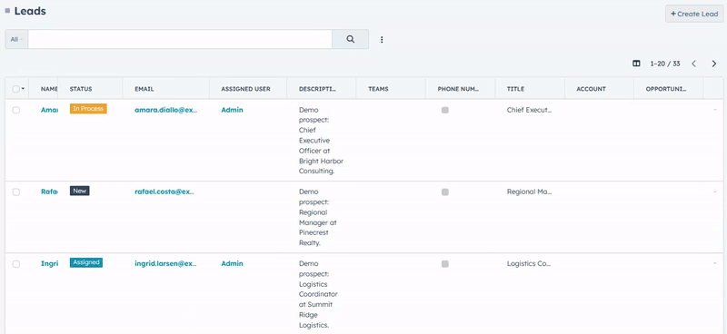
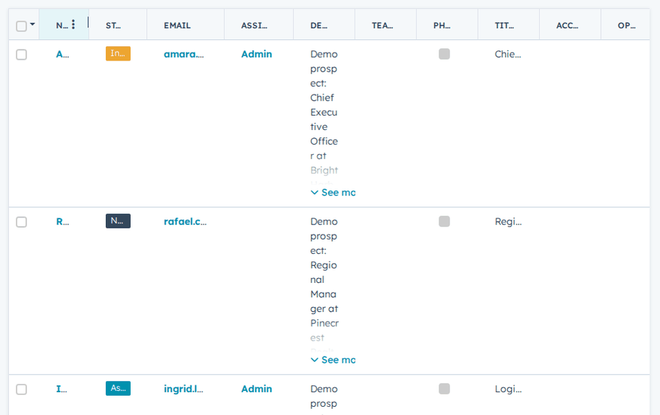
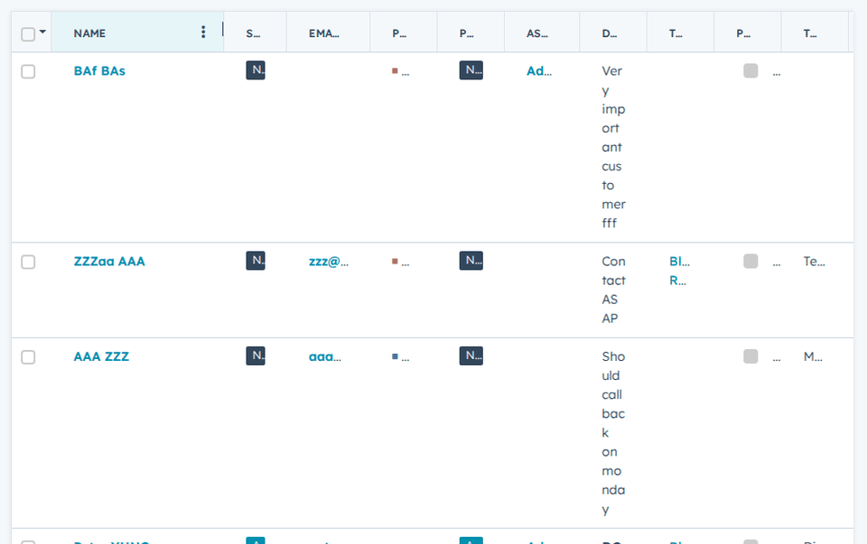
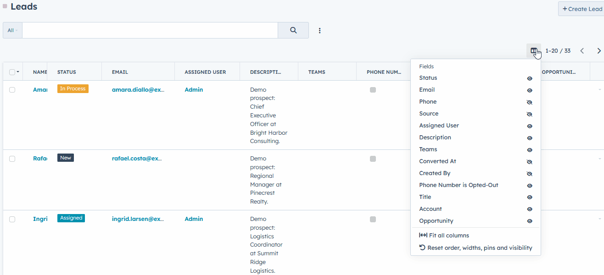
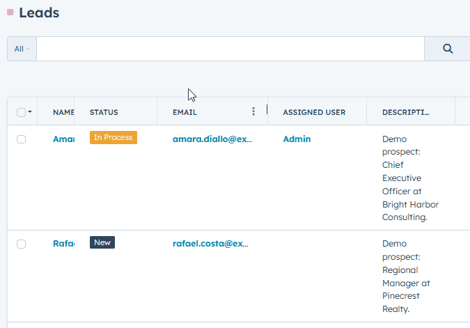
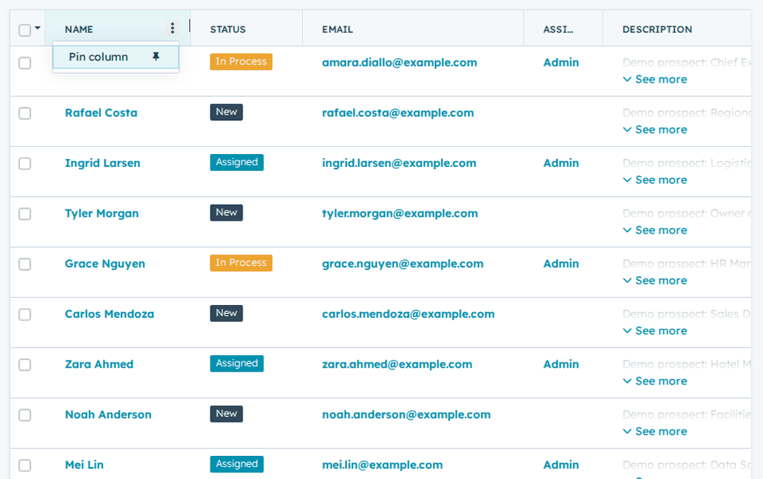
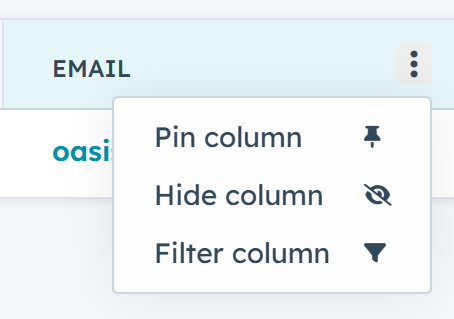
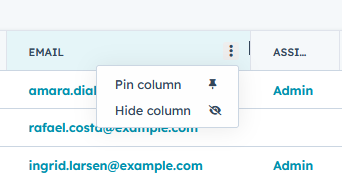
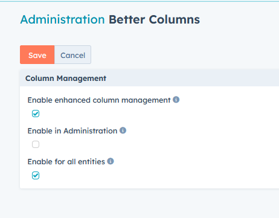

# Better Columns for EspoCRM

Better Columns improves EspoCRM list views with column resizing, double-click
auto-fit, one-click fit for all columns, column reordering, column pinning,
column hiding, persistent personal layouts, and reset controls for column
order, widths, pins and visibility.

Current version: **1.4.0** · [Download the latest release](https://github.com/AlexisSantin/espocrm-better-columns/releases/latest)



## Interaction reference

| Action | Result |
| --- | --- |
| Hover near a header boundary | Shows the column-resize cursor |
| Drag a header boundary | Changes only that column's width |
| Double-click a header boundary | Auto-fits the column to rendered content |
| Click Fit all columns in the Columns menu | Auto-fits every column to its rendered content |
| Drag empty header space | Moves the header and all corresponding cells |
| Click a header's options button (⋯) | Opens the column menu with Pin column or Unpin column, Hide column, and Filter column |
| Click a sortable header label | Keeps EspoCRM's native sorting |
| Change visible columns | Keeps the native column menu open |
| Reset order, widths, pins and visibility | Restores the administrator's order, default visibility and widths, and removes pins |
| Navigate away and return | Restores the personal layout |

## Features

### Resize any visible column

- Move the pointer near the right edge of a column header to reveal the
  resize cursor.
- Drag the boundary to change only that column's width.
- The interaction area extends a few pixels on both sides of the separator,
  making the boundary easier to acquire without requiring pixel-perfect
  positioning.
- Column widths have a compact common minimum, including text, links,
  enumerations and boolean fields.
- Resizing one column does not redistribute the remaining space between the
  other columns.
- When the total width exceeds the list container, EspoCRM's horizontal
  scrolling remains available. The horizontal scrollbar appears only when
  there is content to scroll.

The native **Column Resize** toggle is hidden while Better Columns is
active because resizing is always available directly from the headers.



### Double-click to auto-fit

Double-click a column boundary to fit that column to its rendered content.



Auto-fit measures the current list rows and accounts for:

- text and links;
- email addresses and phone numbers;
- enum labels and their color indicators;
- badges and other label decoration;
- checkboxes and form controls;
- field padding and borders.

The result keeps a compact minimum and a safe maximum so that a single long
value cannot create an excessively wide column.

### Fit all columns

Open the **Columns** menu and choose **Fit all columns** to fit every column to
its rendered content at once. The action uses the same measurement as the
double-click auto-fit, so each column becomes readable without resizing them
one by one.



### Reorder complete columns

- Drag an unused area of a column header to move the column.
- The header and every corresponding row cell move together.
- A short movement is ignored to prevent accidental reordering.
- Native interactive content has priority. Clicking a sortable header label,
  link, button or resize boundary keeps its original EspoCRM action.
- A visual guide shows the destination while dragging.

Reordering changes only the current user's presentation. It does not modify
the administrator's list layout.



### Pin the first columns

- Hover a column header to show its options button (⋯). It is also shown when
  the header has keyboard focus or its menu is open.
- Open the menu and choose **Pin column** or **Unpin column**. Pinned columns
  have no count limit and no width limit.
- Pinned columns move to the start of the list and stay fixed while the rest
  of the table scrolls horizontally. A thin edge marks the last pinned column,
  and a shadow appears along it once the table is scrolled.
- Pinned columns keep their pin order. Drag them among themselves to change
  that order; drag other columns among themselves as before. A column cannot
  be dragged between the pinned and unpinned groups.
- Unpinning a column returns it to its previous position among the other
  columns.
- The menu closes with Escape, a click outside it, or Tab. Use the arrow keys
  and Enter to choose an item from the keyboard.



Pins are part of the personal layout and follow the same storage rules as
widths and order.

### Filter a column from its header



- Open a header's options menu (⋯) and choose **Filter column** to open that
  column's filter in the search panel.
- The item appears only when the administrator has made the field available
  as a list filter, and only for fields you can access.
- If a filter is already applied to the column, the item focuses it instead.
- When a preset other than **All** is selected, the menu switches to **All**
  so the filter can be shown.

### Hide columns

Choose **Hide column** in a header's ⋯ menu to hide that column. It is
unchecked in the native Columns menu, where it can be shown again.



Link fields such as the name column, and columns without a label, cannot be
hidden.

### Persistent personal layout

Widths and order are stored locally through EspoCRM's browser storage.
Preferences are separated by:

- EspoCRM user;
- entity type;
- list layout.

Each user can therefore organize Leads, Contacts, Accounts and custom
entities independently without affecting other users.

Preferences stay on the same browser and computer. They are not synchronized
between devices. Clearing the browser's site storage also clears these
personal column preferences.

### Safe layout reconciliation

Better Columns always starts from the current list layout configured by
an administrator.

When that layout changes:

- newly activated columns are inserted into the personal order;
- removed columns are discarded from stored preferences;
- hidden or unauthorized fields cannot be restored from local storage;
- native column-visibility choices remain untouched.

Only columns active in EspoCRM's **Administration → Entity Manager → Layouts
→ List** layout are managed by the extension.

### Column menu behavior

EspoCRM's native list settings menu remains responsible for showing and
hiding columns. The menu stays open while column choices are changed, making
it possible to configure several columns without reopening it each time.
**Hide column** in a header's ⋯ menu uses the same stored visibility, so the
native menu reflects it immediately. The table-columns button next to the
record count opens this menu.

Better Columns adds:

- **Fit all columns**, described above;
- **Reset order, widths, pins and visibility**, described below.

**Reset order, widths, pins and visibility**

This action:

- clears the current user's stored order, widths and pins for that list;
- clears the current user's column visibility choices, so hidden and shown
  columns return to the administrator's defaults;
- restores the order from the administrator's current list layout;
- recalculates initial widths for the available list area;
- keeps the default view contained in the viewport whenever the number of
  columns makes that possible.

It does not change the fields or the default visibility defined in the
administrator's layout.

### Reliable EspoCRM navigation

EspoCRM caches some list views when users move between entities. Better Columns
handles that lifecycle explicitly, so resizing and reordering remain
active after navigating away from a list and returning to it.

The extension also observes list re-rendering after pagination, sorting,
searches and column changes, then reapplies the saved column model without
replacing the whole EspoCRM list view.

## Administration

After installation, open:

**Administration → Customization → Better Columns**



The page provides five settings:

- **Enable enhanced column management** — global on/off switch.
- **Enable in Administration** — enables Better Columns in Administration
  lists independently from regular record lists. It remains subject to entity
  compatibility and ACL.
- **Enable in bottom panels** — enables Better Columns in relationship lists
  shown at the bottom of a record, such as Target Lists on a Lead or Contact.
  It is disabled by default, so these lists keep EspoCRM's native columns.
- **Enable for all entities** — enables the extension for every compatible
  entity.
- **Enabled entities** — when the previous option is disabled, selects the
  entities on which Better Columns is available.

The entity selector supports standard and custom object entities.

After installation, Better Columns is enabled for all compatible
record-list entities, while Administration lists remain disabled until
**Enable in Administration** is turned on, and bottom-panel lists remain
native until **Enable in bottom panels** is turned on.

The Administration and bottom-panel settings default to disabled.

The settings are stored under these EspoCRM configuration keys:

| Setting | Key | Default |
| --- | --- | --- |
| Enable enhanced column management | `betterColumnsEnabled` | `true` |
| Enable in Administration | `betterColumnsAdminEnabled` | `false` |
| Enable in bottom panels | `betterColumnsBottomPanelEnabled` | `false` |
| Enable for all entities | `betterColumnsAllEntities` | `true` |
| Enabled entities | `betterColumnsEntityList` | `[]` |

## Permissions and ACL

The extension does not grant access to records, entities or fields.

EspoCRM filters the list layout using the current user's entity and
field-level read permissions before Better Columns receives it. Stored
orders and widths are then reconciled only against those authorized columns.

The administration page uses EspoCRM's native Settings model:

- only administrators can open the administration route;
- the server rejects configuration updates from non-administrators;
- the enabled-entity list is filtered according to the current user's scope
  access.

Better Columns changes only table presentation. It does not create,
read, update or delete CRM records through a custom API.

## Installation

1. Download `better-columns-1.4.0.zip` from the
  [latest GitHub release](https://github.com/AlexisSantin/espocrm-better-columns/releases/latest).
2. In EspoCRM, open **Administration → Extensions**.
3. Upload the ZIP file without extracting it.
4. Install the extension.
5. Reload EspoCRM in the browser.
6. Configure activation and entity scope under
  **Administration → Customization → Better Columns**.

### Upgrade

Download a newer Better Columns ZIP and install it from
**Administration → Extensions**. Personal browser widths and orders, as well
as administration settings, are preserved between Better Columns releases.

### Uninstall

Uninstall the extension from **Administration → Extensions**. CRM records and
administrator list layouts are never modified by the extension.

Local browser preferences may remain in site storage after uninstalling, but
they are harmless and are ignored when the extension is absent.

## Requirements and compatibility

- EspoCRM `>= 10.0.0`
- PHP `>= 8.3`
- A modern desktop browser

Version 1.4.0 has been developed and tested against EspoCRM 10.0.3.

Resize handles are intentionally hidden on small mobile viewports, where
horizontal touch scrolling has priority.

## Troubleshooting

### Resize handles are not available

Check that:

- Better Columns is enabled globally;
- **Enable in Administration** is turned on when using an Administration
  list;
- the current entity is enabled in the extension settings;
- the browser viewport is wider than the mobile breakpoint;
- the extension is installed and enabled under
  **Administration → Extensions**.

Reload the browser without cache after installing or upgrading. Depending on
the browser, use `Ctrl+Shift+R` or `Ctrl+F5`.

### Widths differ on another browser or computer

This is expected. Preferences are stored locally for fast, per-device
feedback and are not server-side user preferences.

### An administrator changed the list layout

Reload the list. Better Columns automatically reconciles personal
preferences with the latest active fields and discards obsolete entries.

### Restore the default presentation

Open the **Columns** menu and choose **Reset order, widths, pins and visibility**. To remove
all local preferences for the site, clear the site's browser storage.

### The native Column Resize option reappears

Reload without cache and clear EspoCRM's application cache. If the problem
persists, include the EspoCRM version, browser and reproduction steps in a
GitHub issue.

## Repository structure

This repository is based on the official
[EspoCRM extension template](https://github.com/espocrm/ext-template).

Important paths:

```text
src/                 Extension source and packaged files
src/files/           Files installed into EspoCRM
src/tests/           JavaScript behavior and metadata tests
scripts/             Helper scripts, such as README screenshot capture
docs/screenshots/    Screenshots and GIFs used by this README
build/               Generated installable ZIP packages
site/                Local EspoCRM development instance
```

Develop the extension only in `src`. The `site` directory is a generated
development copy and must not be edited directly.

## Development

### Prerequisites

- Node.js 18 or newer
- npm 8 or newer
- PHP 8.3 or newer
- Composer
- a local EspoCRM development environment

### Initial setup

```bash
npm install
cp config-default.json config.json
npm run all
```

Adapt `config.json` to the local database and EspoCRM URL before running the
full build.

### Daily workflow

```bash
# Copy source changes into the development EspoCRM instance.
npm run sync

# Clear EspoCRM cache after metadata changes.
npm run clear-cache

# Run behavior and package metadata tests.
npm test

# Build the installable extension.
npm run extension
```

The generated package is written to:

```text
build/better-columns-<version>.zip
```

### README GIFs

`scripts/capture-readme.py` regenerates the GIFs in `docs/screenshots/` from
a running EspoCRM instance with Playwright and Pillow:

```bash
pip install playwright pillow
python -m playwright install --with-deps chromium

ESPO_URL=http://127.0.0.1:8080 \
ESPO_USER=admin \
ESPO_PASSWORD=... \
ESPO_ENTITY=Lead \
python scripts/capture-readme.py
```

Credentials are read only from environment variables and are never stored.
`ESPO_ENTITY` defaults to `Lead`. The script resets the list layout of the
signed-in user, so run it on a development instance.

The demo `smart-columns.gif` at the top of this README is recorded manually and
is not produced by the script.

## Contributing

Issues and pull requests are welcome.

When contributing:

1. Keep extension changes in `src`.
2. Preserve EspoCRM's native sorting, visibility and list interactions.
3. Respect entity, record and field-level ACL.
4. Inspect the implementation in the supported EspoCRM version before using
   an internal list-view property.
5. Add or update tests for behavior changes.
6. Run `npm test` and build the ZIP before opening a pull request.

## Support

Use GitHub Issues for reproducible bugs and feature requests. Include:

- the Better Columns version;
- the EspoCRM version;
- the browser and operating system;
- the affected entity and field types;
- reproduction steps;
- relevant browser-console or EspoCRM log messages.

## Security

Please do not publish credentials, customer records or other sensitive CRM
data in an issue. Use anonymized examples and remove personal information
from screenshots and logs.

## License

Better Columns is free software licensed under the
[GNU General Public License v3.0 or later](LICENSE).

## Author

Created by Alexis SANTIN.
